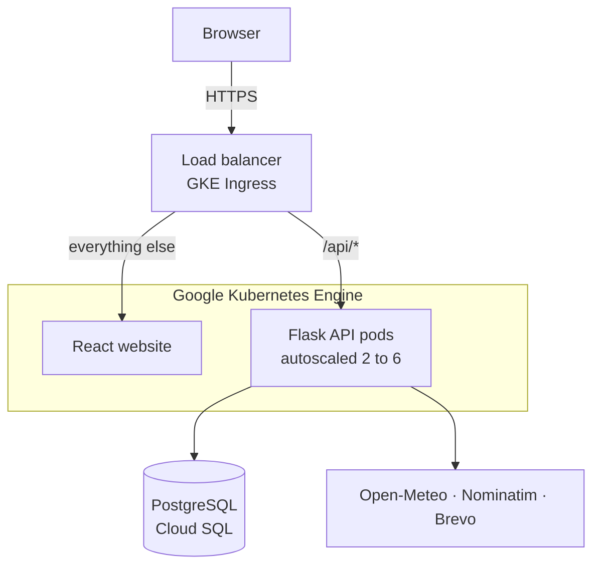

# Buddy Finder

**Find your people before the event starts.**

Buddy Finder puts students who have a ticket for the same Students' Union event into small groups of 3–4 with shared interests, and gives each group a meeting point. No phone numbers or emails are shared.

Group mini project for **ECS781P Cloud Computing**, Queen Mary University of London (2026/27). Status: in development, due 10 December 2026.

> Student prototype designed for Queen Mary Students' Union. Not an official QMSU product.

## How it works

1. Staff create an event; the app adds its map location and weather forecast.
2. A student claims a ticket (the SU ticketing platform, Native, is simulated with a webhook).
3. The student opts in and picks interests from a fixed list.
4. The app matches them into a group of 3–4 and emails everyone the meeting point.

## Architecture



The API is stateless (JWT login), so Kubernetes can add pods under load. Details in [`docs/architecture.md`](docs/architecture.md).

**Stack:** Flask, flask-smorest, SQLAlchemy, React (Vite), PostgreSQL on Cloud SQL, Docker, GKE, bcrypt, JWT, pytest, Locust.

## How this project meets the brief

| Requirement | Points | Where |
| --- | --- | --- |
| REST API with CRUD and correct status codes | 6 | `backend/app/routes/`, Swagger at `/api/docs` |
| External REST services | 6 | `backend/app/services/` |
| Cloud database | 5 | Cloud SQL, `backend/migrations/` |
| Documented code | 1 | Docstrings, this README, `docs/` |
| Load balancing and scaling | 10 | `k8s/`, `loadtest/` |
| HTTPS | 3 | `k8s/` Ingress with TLS |
| Hash-based authentication | 3 | `backend/app/auth/` |
| User accounts and access management | 3 | Student and staff roles |
| Database role-based policies | 3 | `db/roles.sql` |

## Getting started

Needs Git and Docker Desktop. (Works once the project skeleton is merged.)

```bash
git clone https://github.com/LizethPatino/buddy-finder.git
cd buddy-finder
cp .env.example .env
docker compose up --build
```

Website at http://localhost:5173, API docs at http://localhost:5000/api/docs. Tests: `cd backend && pytest`.

Endpoints and error format: [`docs/api.md`](docs/api.md).

## Team

| Area | Who |
| --- | --- |
| Backend and website | Anggy Patiño |
| Cloud and scaling | [Name] |
| Database | [Name] |
| Integrations and docs | [Name] |

How we work: [CONTRIBUTING.md](CONTRIBUTING.md).

## Licence

[MIT](LICENSE). Copyright (c) 2026 the Buddy Finder team.
