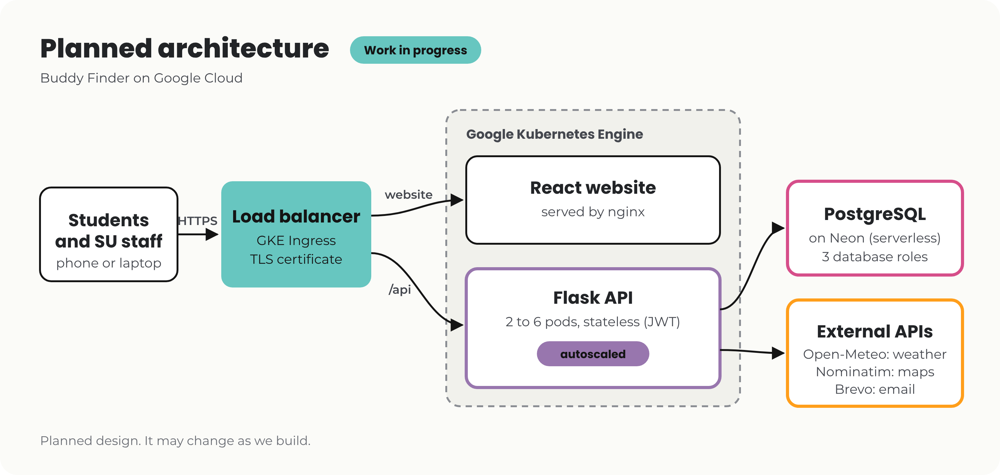

# Buddy Finder


**Find your people before the event starts.**

> [!IMPORTANT]
> **This project is in progress.** We are building it now; the app is not running yet. See [Project status](#project-status) for what is done and what is next. Due 10 December 2026.

Buddy Finder will put students who have a ticket for the same Students' Union event into small groups of 3–4 with shared interests, and give each group a meeting point. No phone numbers or emails are shared.

Group mini project for **ECS781P Cloud Computing**, Queen Mary University of London (2026/27).

> Student prototype designed for Queen Mary Students' Union. Not an official QMSU product.

## How it will work

1. Staff create an event; the app adds its map location and weather forecast.
2. A student claims a ticket (the SU ticketing platform, Native, is simulated with a webhook).
3. The student opts in and picks interests from a fixed list.
4. The app matches them into a group of 3–4 and emails everyone the meeting point.

## Planned architecture



The API is stateless (JWT login), so Kubernetes can add pods under load. Details in [`docs/architecture.md`](docs/architecture.md).

**Stack:** Flask, flask-smorest, SQLAlchemy, React (Vite), PostgreSQL on Neon, Docker, GKE, bcrypt, JWT, pytest, Locust.

## Project status

- [x] Idea, scope and API contract
- [x] UI mockups
- [x] Repository setup and team guides
- [ ] Project skeleton and local setup with Docker Compose
- [ ] Accounts, login and roles
- [ ] Events, tickets and group matching
- [ ] Weather, maps and email integrations
- [ ] React website
- [ ] Deployment on Google Kubernetes Engine with HTTPS
- [ ] Load test and autoscaling

## Getting started

> Available once the project skeleton is merged.

Needs Git and Docker Desktop.

```bash
git clone https://github.com/LizethPatino/buddy-finder.git
cd buddy-finder
cp .env.example .env
docker compose up --build
```

Website at http://localhost:5173, API docs at http://localhost:5000/api/docs. Tests: `cd backend && pytest`.

Planned endpoints and error format: [`docs/api.md`](docs/api.md).

## Team

Built together by the Buddy Finder team.

| Name | Area |
| --- | --- |

Each of us adds our own row in our first pull request. How we work: [CONTRIBUTING.md](CONTRIBUTING.md).

## Licence

[MIT](LICENSE). Copyright (c) 2026 the Buddy Finder team.
