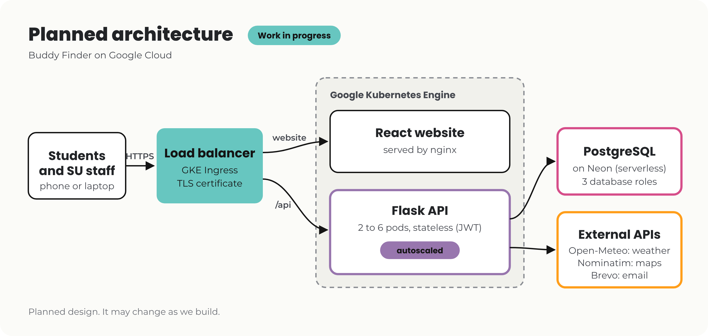

# Architecture

Buddy Finder will run on Google Cloud. One HTTPS load balancer will be the single way in: requests to `/api/*` go to the Flask API, everything else goes to the React website. Both will run as containers in one Google Kubernetes Engine (GKE) cluster.



> This is the planned design. It may change as we build.

## Key decisions

| Decision | Why |
| --- | --- |
| One domain, one load balancer | One TLS certificate, no CORS setup between frontend and API. |
| Stateless API with JWT tokens | No pod stores sessions, so any pod can answer any request. This is what lets Kubernetes scale the API freely. `/api/health` returns the pod name, so we can see different pods answering. |
| PostgreSQL on Neon | A managed, serverless Postgres: free, no credit card, and it sleeps when idle. The API connects over an encrypted (SSL) connection string kept in Kubernetes Secrets. The same database can later power a free portfolio version. |
| Database roles | The app connects as `bf_app`, which can read and write data but cannot create, alter or drop tables. Migrations use `bf_migrator`; admin stats use `bf_analytics`, which can only read a stats view. |
| External APIs protected from load | Weather is cached in the database for 1 hour; venues are geocoded once, when an event is created; every external call has a timeout; if email fails, the group is still created and the error is logged. |
| Login rate limit per account | A per-IP limit would block our load test, which sends every request from one machine. Each pod keeps its own counter: a known limitation of this prototype. |
| Native is simulated | Native (the Students' Union ticketing platform) has no public API, so `POST /api/webhooks/native/ticket-claimed` receives the message Native would send. |
| Runs locally with Docker Compose | The whole team can develop without Google Cloud or credits. |

## Backend layers

The Flask code is organised in layers. Each layer only calls the one below it.

```text
routes/    → read the HTTP request, call a service, return a status code   (REST API)
services/  → the real logic: matching, weather, geocoding, email          (external APIs)
models/    → the database tables, through SQLAlchemy                      (cloud database)
auth/      → password hashing and role checks, used by the routes         (security)
schemas/   → what each request and response must contain; also builds the Swagger docs
```

## Data model

| Table | Columns |
| --- | --- |
| `users` | id, name, email (unique), password_hash, role (student or staff), created_at |
| `events` | id, title, venue, latitude, longitude, starts_at, meeting_point, native_url, weather (jsonb), weather_updated_at, created_by |
| `tickets` | id, user_id, event_id, claimed_at — one ticket per user per event |
| `buddy_groups` | id, event_id, created_at — at most 4 members |
| `optins` | id, user_id, event_id, interests (text[]), group_id, membership (pending, accepted or declined), created_at — one per user per event |

Setup, roles and the rules the database enforces: [`database.md`](database.md).

## Matching rule

When a student opts in, they join the open group for that event (fewer than 4 members) that shares the most interests with them, as long as they share at least one. If there is none, a new group starts. The group is announced by email once it reaches 3 members.
